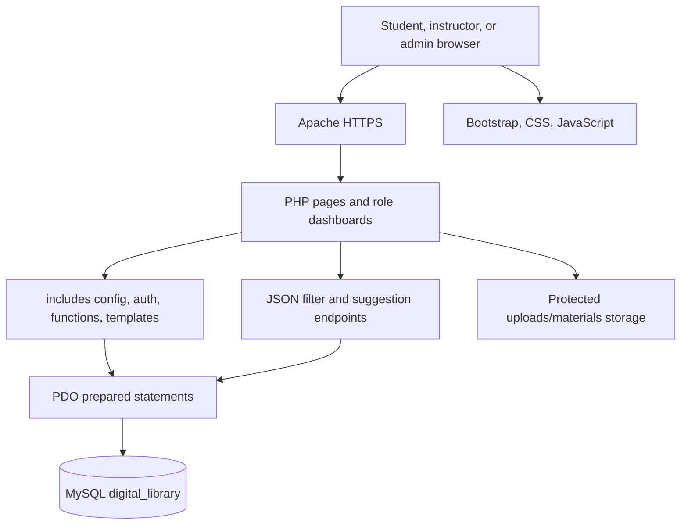
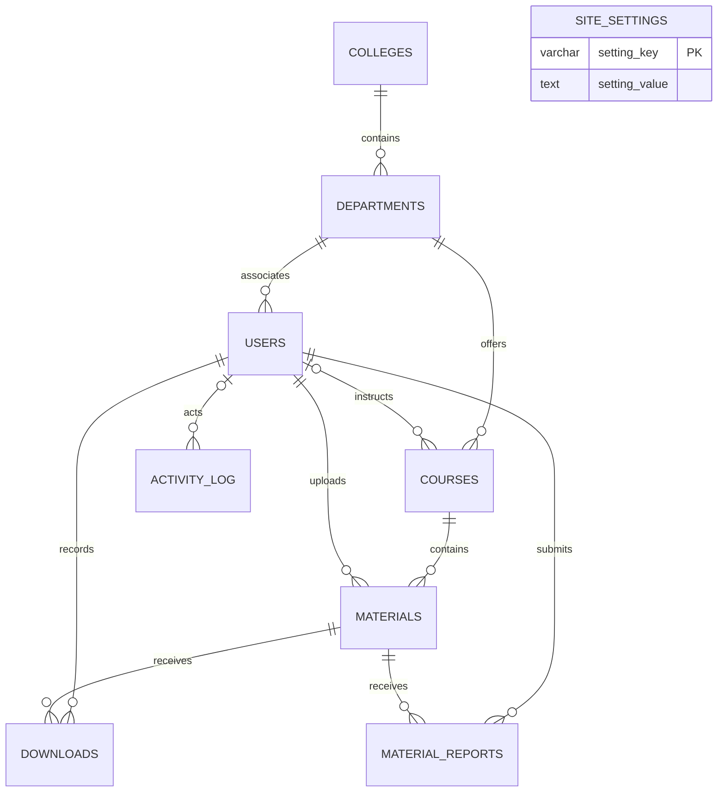

# Technical Documentation

## Architecture

The app is a server-rendered PHP application. Pages call shared PDO helpers, read or update MySQL through prepared statements, then render Bootstrap HTML. Small JSON endpoints support dependent filters, search suggestions, and the student's local bookmarks.

## Request flows

- **Authentication:** Registration validates input and stores `password_hash()` output. Login verifies the hash, regenerates the session ID, and routes by role. Protected pages check the session timeout, account activation, and role.
- **Upload and approval:** An instructor submits a department-scoped course and file. The server checks size, extension, MIME/content, generates a random stored filename, and inserts a pending record. Admin actions set `approved` to `1` or `0`; edits return a record to pending (`NULL`).
- **Download:** The PHP handler requires a current account, selects only an approved material, checks the resolved file path is inside the storage directory, records a download event and increments its count in a transaction, then streams the file with attachment headers.
- **Search:** A GET request applies only validated filters and prepared parameters, limits results to approved content, sorts with a fixed allowlist, and paginates ten rows at a time.

## Database relationships

`materials.approved` represents moderation state: `NULL` pending, `1` approved, and `0` rejected. Public retrieval and download queries must require `approved = 1`.

## Project files

- Root pages: `index.php`, `search.php`, `browse.php`, `course.php`, `material.php`, `download.php`, `login.php`, `register.php`, `logout.php`.
- `admin/`: administrator dashboard, users, courses, colleges/departments, settings, moderation, and reports.
- `instructor/`: instructor dashboard, upload, edit, and upload list.
- `student/`: student dashboard with department recommendations, recent downloads, and browser-saved materials.
- `api/`: JSON endpoints for dependent filters, suggestions, and bookmark metadata.
- `includes/`: PDO/session configuration, authentication and CSRF helpers, reusable UI templates.
- `assets/`: styles, browser JavaScript, and administrator-managed logo images.
- `database/`: fresh-install schema/sample data and separate executable query examples.
- `uploads/materials/`: protected file storage. Production should move it outside the public document root.
- `tests/`: lightweight database-independent PHP helper tests.

## Security controls

- PDO prepared statements for database values; sort expressions and SQL identifiers come from fixed allowlists.
- `htmlspecialchars()` via `e()` for HTML output, input validation at server boundaries, password hashing/verification, and generic login errors.
- CSRF tokens on state-changing forms; same-site, HTTP-only session cookies; strict session mode, login-time session ID regeneration, inactivity timeout, and active-account checks.
- Role checks on instructor/student/admin routes.
- Upload allowlist, size limit, content inspection, random names, protected Apache directories, and authenticated download streaming with path containment checks.
- Database exceptions are logged; database connection errors return a generic unavailable response. Set `APP_ENV=production` to disable PHP error display.
- HTTPS is required in production to protect credentials and enable secure cookies.

## API endpoints

- `GET api/filters.php`: returns department/year/semester/course options for the selected parent curriculum filters.
- `GET api/suggestions.php?q=...`: returns up to eight approved matching materials.
- `GET api/materials.php?ids=...`: returns up to twenty approved bookmark records for the current browser's saved IDs.

The endpoints return JSON and use prepared statements. They do not expose file paths or unapproved records.

## Future enhancements

- Store user year/semester preferences to improve recommendations beyond department matching.
- Move uploaded objects to storage outside the web root or managed object storage; add malware scanning and checksum verification.
- Add email verification, self-service password recovery, and university identity integration.
- Add multilingual Afaan Oromo and Amharic interface translations, moderation reasons, audit retention controls, and richer accessibility/usability testing.
- Add automated integration tests against a disposable MySQL service and load testing with representative material sizes.